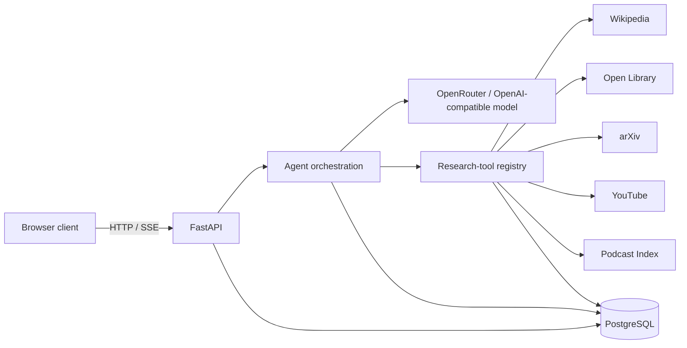
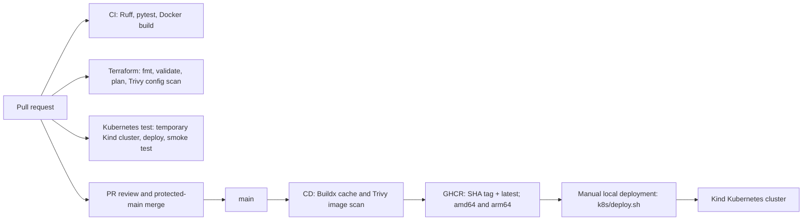

# The Rabbit Hole

The Rabbit Hole is an AI research assistant that turns a topic into a streamed, source-backed exploration rather than a flat search result. A FastAPI service coordinates an OpenAI-compatible model, selected research tools, token-aware conversation memory, rate limiting, and PostgreSQL persistence; a lightweight browser client renders the live response and sources.

It is also a practical DevOps portfolio project: the repository has protected-branch delivery, tested Docker builds, container vulnerability scanning, multi-architecture image publishing, local Terraform-managed Kubernetes, and a disposable Kubernetes deployment test in GitHub Actions.

## Highlights

- Researches across Wikipedia, Open Library, arXiv, YouTube, and Podcast Index.
- Streams responses and tool progress to the browser with Server-Sent Events (SSE).
- Persists sessions, messages, source/tool activity, API usage, and cached responses in PostgreSQL.
- Builds a non-root, multi-stage Python image and publishes `linux/amd64` and `linux/arm64` variants to GHCR.
- Validates infrastructure and runs an end-to-end deployment smoke test in a temporary Kind cluster.

## Architecture



The agent chooses relevant sources instead of calling every integration. Results are cached, external throttling is handled safely, and only a token-budgeted portion of conversation history is sent to the model.

## Delivery pipeline



The Kubernetes workflow is an integration test, not an automatic production deployment. It creates a throwaway cluster with Terraform, deploys the PR image with fake secrets, checks `/health` and the database schema, prints diagnostics on failure, and destroys the cluster in all cases.

## Quick start: Docker Compose

Prerequisites: Docker Desktop and Docker Compose.

```bash
cp .env.example .env
# Populate the API keys in .env, then:
docker compose up --build
```

The API is available at `http://localhost:8000`; confirm it with:

```bash
curl http://localhost:8000/health
```

Compose starts PostgreSQL first, initializes it from `migrations/001_initial_schema.sql`, stores data in the named `pgdata` volume, and starts the API only after the database health check succeeds. The app connects to the Compose service name `db`, not `localhost`.

To stop the stack, use `docker compose down`. Add `-v` only when you deliberately want to remove the local database volume.

## Local Kubernetes deployment

Prerequisites: Docker Desktop, Terraform, Kind, `kubectl`, and a populated local `.env` file. Do not commit `.env`, Terraform state, or the generated Kind kubeconfig.

### 1. Create the cluster and namespace

```bash
cd infra/terraform
terraform init
terraform apply
kubectl --context kind-rabbit-hole get nodes
cd ../..
```

Terraform creates a control-plane node, a worker node, and the `rabbit-hole` namespace. Its lock file is committed so provider selection is reproducible across macOS and Linux; local state is ignored.

### 2. Deploy an image

`k8s/deploy.sh` creates the Kubernetes Secret from `.env` and the database initialization ConfigMap from the migration file. Deploy a published GHCR image by SHA:

```bash
IMAGE_TAG=<commit-sha> ./k8s/deploy.sh
kubectl --context kind-rabbit-hole -n rabbit-hole get pods,svc,pvc
kubectl --context kind-rabbit-hole -n rabbit-hole port-forward svc/app 8000:8000
```

In a second terminal:

```bash
curl http://localhost:8000/health
```

The application runs as a Deployment with a database-waiting init container, readiness and liveness probes, resource requests/limits, and a non-root security context. PostgreSQL runs as a StatefulSet backed by a persistent volume.

To remove the local cluster and its managed resources:

```bash
cd infra/terraform
terraform destroy
```

## CI/CD

| Workflow | Trigger | What it verifies or produces |
| --- | --- | --- |
| `ci.yml` | Every PR and push to `main` | Installs Python 3.12 dependencies, runs Ruff and pytest, then verifies a Docker build. Pip caching is enabled. |
| `cd.yml` | Every PR and push to `main` | Builds an image, scans it with Trivy for unfixed `HIGH`/`CRITICAL` findings, and—on `main` only—publishes GHCR images. Docker layer caching uses GitHub Actions cache storage. |
| `terraform.yml` | Terraform or workflow changes | Runs `fmt -check`, lockfile-only init, validate, plan (added to the job summary), and a Trivy configuration scan. |
| `k8s-deploy.yml` | App, image, Kubernetes, or Terraform changes | Creates a temporary Kind cluster, loads the PR image, deploys it, smoke-tests the API and schema, shows diagnostics on failure, and always destroys the cluster. |

Published container tags are:

```text
ghcr.io/srijan1683/the-rabbit-hole:<commit-sha>
ghcr.io/srijan1683/the-rabbit-hole:latest
```

PRs build and scan but cannot publish images. `main` is protected: changes arrive through pull requests, and force pushes are blocked. Workflow jobs use least-privilege permissions where publishing is not required, and in-progress runs for the same ref are cancelled when superseded.

Dependabot checks Python, Docker, and GitHub Actions dependencies weekly; minor/patch Python updates and Actions updates are grouped to reduce PR noise.

## Results

| Measure | Baseline | Current result | Improvement / note |
| --- | ---: | ---: | --- |
| Uncompressed production image | 1.79 GB | 330 MB | 81.6% smaller |
| Compressed image transfer size | 451 MB | 67 MB | 85.1% smaller |
| Automated tests | 0 | 9 | API integrations are mocked with `respx`; the health endpoint and token/cache behavior are covered. |
| CI duration | Not benchmarked | Pip and Docker layer caching enabled | Record comparable uncached/cached workflow runs before making a timing claim. |
| Merge to published image | Not benchmarked | SHA and `latest` images are published by the `main` CD workflow | Record the GitHub Actions workflow duration before making a timing claim. |

## Runbook

| Symptom | Checks | Recovery |
| --- | --- | --- |
| Deployment fails | `kubectl --context kind-rabbit-hole -n rabbit-hole get pods,svc,pvc` and `kubectl ... get events --sort-by=.lastTimestamp` | Inspect `kubectl ... describe pod <name>` and the relevant logs; correct the manifest or secret, then rerun `k8s/deploy.sh`. |
| Database is unavailable | `kubectl --context kind-rabbit-hole -n rabbit-hole get pod db-0` and `kubectl ... logs statefulset/db` | Confirm the PVC is bound and `db-0` is `1/1 Running`. The app init container will wait until the `db` service is ready. |
| Image will not pull | `kubectl --context kind-rabbit-hole -n rabbit-hole describe pod <name>` | Verify the SHA tag exists in GHCR, the image reference is exact, and the cluster can authenticate to a private package if the package is not public. |
| API cannot be reached locally | Keep `kubectl ... port-forward svc/app 8000:8000` running in one terminal, then use `curl http://localhost:8000/health` in another | Check app logs with `kubectl ... logs deployment/app`; `port-forward` is expected to remain in the foreground. |

## Decisions and trade-offs

| Decision | Why | Trade-off |
| --- | --- | --- |
| Multi-stage `python:3.12-slim` image | Keeps runtime dependencies separate, reduces image size, and runs the service as UID `10001`. | Slim images require deliberate dependency management and do not include a broad debugging toolset. |
| SHA image tags plus `latest` | A SHA identifies the exact source revision deployed; `latest` remains convenient for local use. | Operators must select the intended SHA rather than relying on a mutable tag. |
| Terraform-managed Kind cluster | Makes Kubernetes infrastructure repeatable, inexpensive, and suitable for a disposable CI environment. | It is local-cluster infrastructure, not a production cloud deployment. |
| PostgreSQL StatefulSet with a PVC | Preserves database data across pod replacement and models a stateful workload realistically. | It is a single-instance database with no HA, backups, or managed-database operations. |
| Local secrets created from `.env` | Keeps credentials and generated kubeconfig data out of Git. | Secret rotation and remote secret management are not automated. |

Known limitations: the frontend API URL is configured statically, CORS currently permits all origins, external research/model calls require provider credentials, and Kubernetes deployment is manual rather than a production GitOps release.

## Engineering milestones resolved

1. **Repository hygiene:** added issue and PR templates, labels, a milestone, and protected `main`; worked through issue, branch, PR, self-review, and squash merge. Fixed an empty template and removed a GitHub-side branch left after local deletion.
2. **Linting and tests:** fixed Ruff findings, added pytest coverage and mocked external APIs with `respx`, introduced `requirements-dev.txt`, and supplied test-only environment values during import.
3. **CI:** added a required PR/main workflow for linting, tests, and Docker build verification with pip caching and read-only permissions.
4. **Docker:** replaced a 1.79 GB baseline with a multi-stage, non-root, health-checked image; added `.dockerignore` and a Compose stack that runs both the API and PostgreSQL.
5. **CD and dependency management:** added Buildx, Trivy, multi-architecture GHCR publishing, SHA tags, Dependabot grouping, and a policy to decline untested Python runtime changes. Corrected workflow typos and the Trivy action version.
6. **Terraform:** added a repeatable local Kind cluster and namespace with a committed cross-platform provider lock file and ignored state.
7. **Terraform CI:** added formatting, locked initialization, validation, plan summaries, and Trivy configuration scanning; corrected action/tag, shell-pipeline, and quoting issues.
8. **Kubernetes manifests:** added a persistent PostgreSQL StatefulSet and a secured API Deployment with probes, resources, and database readiness gating; deploy secrets are generated from `.env`.
9. **Kubernetes CI deployment test:** added a temporary Terraform/Kind deployment that loads the PR image, uses fake secrets, validates the health endpoint and schema, emits failure diagnostics, and always cleans up.

## API and data

| Area | Endpoints / behavior |
| --- | --- |
| Sessions | Create, list, retrieve, delete, and inspect session history/tool calls under `/sessions`. |
| Exploration | `POST /explore` returns a complete result; `GET /explore/stream` streams a new exploration; `GET /explore/{session_id}/stream` streams a follow-up. |
| Operations | `/health`, `/tools`, and `/rate-limits` support health and runtime inspection. |
| Persistence | Raw SQL through `asyncpg` stores sessions, conversation history, tool calls, API usage, and cached responses. |

## License

All rights reserved. See [LICENSE](LICENSE).
